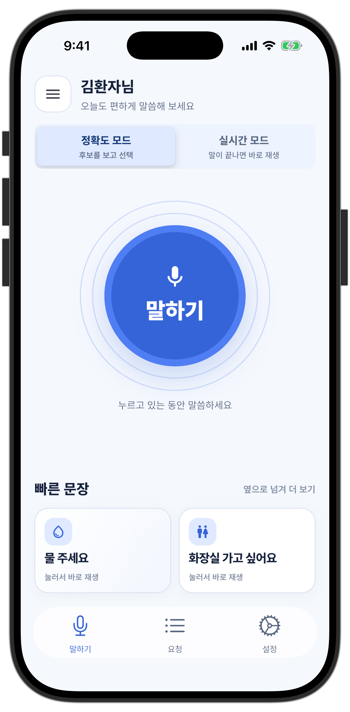
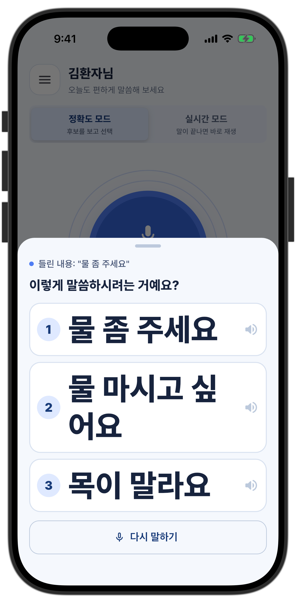
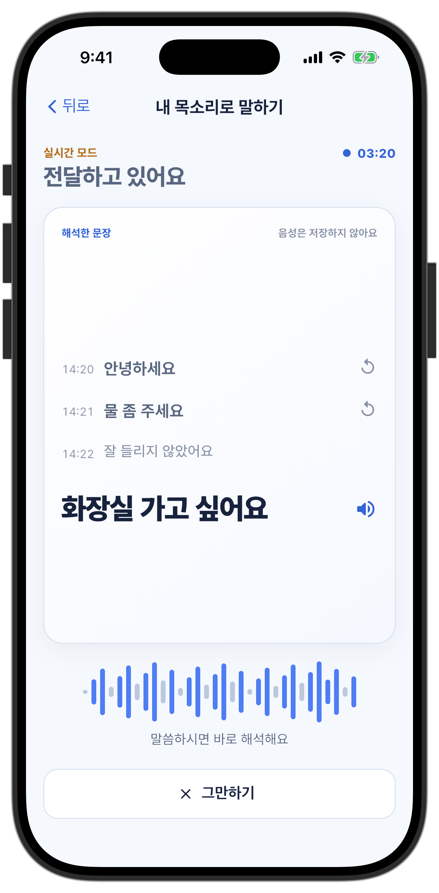
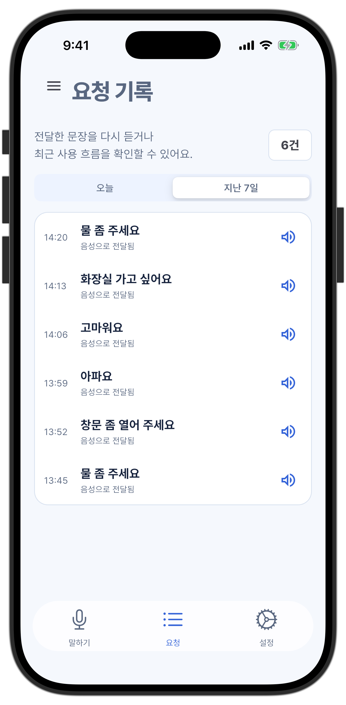
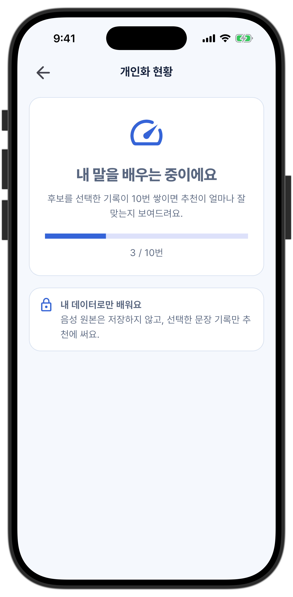
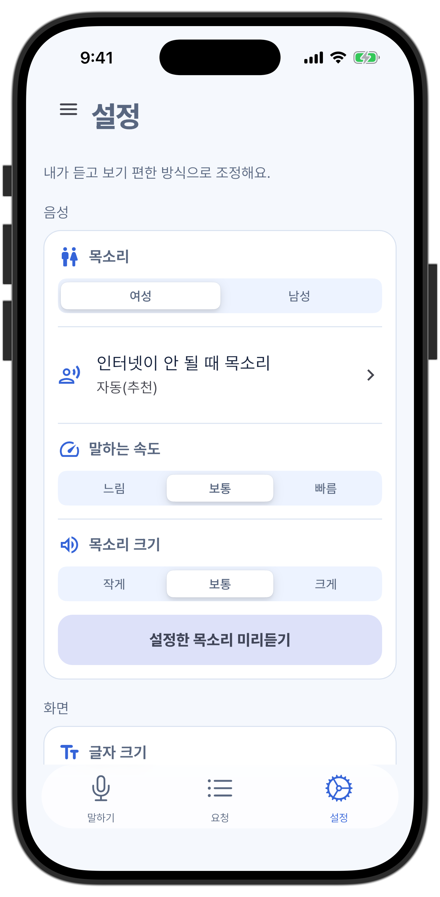

<p align="center">
  
</p>

# 말이음 (Marieum)

<p align="center">
  <b>당신의 말을 더 또렷하게 이어주는 개인화 음성 AAC 앱</b><br/>
  구음장애가 있는 사용자가 자신의 말을 전하고, 추천 문장을 골라 소리로 전달하는 Flutter 애플리케이션
</p>

<p align="center">
  
  
  
  
  
</p>

<p align="center">
  <a href="#running-locally">실행 방법</a> ·
  <a href="#environment-variables">환경변수 3개</a> ·
  <a href="#communication-pipeline">통신 흐름</a> ·
  <a href="#screens">화면 보기</a>
</p>

<p align="center">
  
  
  
</p>

## Overview

말이음은 발음이 명확하지 않아도 사용자가 원하는 말을 직접 전달하도록 돕는 보완대체의사소통(AAC) 앱입니다.
`발화 → 음성 인식 → 문장 확인·추천 → 음성 전달`을 하나의 흐름으로 연결합니다.

**후보를 확인하는 정확도 모드**와 **대화를 이어가는 실시간 모드**를 제공하고, 빠른 문장·요청 기록·개인화 현황·음성 설정을 함께 구성했습니다.
이 저장소는 모바일 클라이언트이며, ASR과 추천 결과는 별도 백엔드·ML 서비스에서 받습니다.

## Running Locally

기준 개발 SDK는 **Flutter 3.44.2 / Dart 3.12.2**입니다. 모든 명령은 저장소 루트에서 실행합니다.

```bash
git clone https://github.com/team-agent-5/marieum-app.git
cd marieum-app
flutter pub get
flutter devices
```

Android는 Android SDK 37과 JDK 17, iOS는 macOS·Xcode·CocoaPods가 필요합니다. iOS 의존성은 다음과 같이 준비합니다.

```bash
cd ios
pod install
cd ..
```

### Environment Variables

앱은 `.env` 파일을 자동으로 읽지 않습니다. 아래 **환경변수 3개를 `--dart-define`으로 전달**해야 합니다.

| 환경변수 | 용도 | 생략했을 때 |
| --- | --- | --- |
| `API_BASE_URL` | 로그인·전사·추천·기록 등 HTTP API의 루트 주소 | `https://unity-cohen-reality-lived.trycloudflare.com` |
| `WS_BASE_URL` | 실시간 음성 스트리밍 서버 주소 | `API_BASE_URL`에서 `ws` / `wss` 주소를 만들고 `/ws/phrase/stream`에 연결 |
| `COPA_API_KEY` | 선택 사항. COPA 게이트웨이의 클라우드 TTS 인증 키 | 빈 값. 기기 내장 한국어 TTS 사용 |

먼저 공통 값을 설정합니다. 터널 주소가 변경되면 현재 제공받은 서버 주소로 바꾸세요.

```bash
export API_BASE_URL='https://unity-cohen-reality-lived.trycloudflare.com'
export WS_BASE_URL='wss://unity-cohen-reality-lived.trycloudflare.com/ws/phrase/stream'
export COPA_API_KEY=''
```

클라우드 음성이 필요할 때만 `COPA_API_KEY`에 발급받은 키를 설정합니다. 실제 키는 README나 저장소에 커밋하지 않습니다.
정확도 모드는 키 설정과 관계없이 기기 TTS를 사용하며, 실시간 모드는 준비된 클라우드 음성 캐시가 없으면 기기 TTS로 바로 재생합니다.
환경변수는 빌드 시 반영되므로 변경 후에는 hot reload 대신 앱을 다시 실행합니다.

### 1. Android Emulator

에뮬레이터를 켠 뒤 `flutter devices`에 표시된 Android 기기 ID를 사용합니다.

```bash
export ANDROID_DEVICE_ID='emulator-5554'
flutter run -d "$ANDROID_DEVICE_ID" \
  --dart-define=API_BASE_URL="$API_BASE_URL" \
  --dart-define=WS_BASE_URL="$WS_BASE_URL" \
  --dart-define=COPA_API_KEY="$COPA_API_KEY"
```

### 2. iOS Simulator

Simulator를 켠 뒤 아래 값을 `flutter devices`에 표시된 시뮬레이터 ID로 바꿉니다.

```bash
export IOS_SIMULATOR_ID='<iOS_SIMULATOR_ID>'
flutter run -d "$IOS_SIMULATOR_ID" \
  --dart-define=API_BASE_URL="$API_BASE_URL" \
  --dart-define=WS_BASE_URL="$WS_BASE_URL" \
  --dart-define=COPA_API_KEY="$COPA_API_KEY"
```

### 3. Physical Device

휴대폰을 연결하고 개발자 모드·신뢰 설정을 완료한 뒤, 실제 기기 ID를 사용합니다. iOS 실기기는 Xcode에서 서명 팀 설정도 필요합니다.

```bash
export PHONE_DEVICE_ID='<PHONE_DEVICE_ID>'
flutter run -d "$PHONE_DEVICE_ID" \
  --dart-define=API_BASE_URL="$API_BASE_URL" \
  --dart-define=WS_BASE_URL="$WS_BASE_URL" \
  --dart-define=COPA_API_KEY="$COPA_API_KEY"
```

로컬 PC에서 백엔드를 띄우는 경우에는 공통 환경변수의 호스트를 아래 기준으로 바꿉니다.

| 실행 환경 | 로컬 백엔드 주소 예시 | WebSocket 주소 예시 |
| --- | --- | --- |
| Android Emulator | `http://10.0.2.2:8000` | `ws://10.0.2.2:8000/ws/phrase/stream` |
| iOS Simulator | `http://127.0.0.1:8000` | `ws://127.0.0.1:8000/ws/phrase/stream` |
| Android / iOS 실기기 | `http://<PC의_LAN_IP>:8000` | `ws://<PC의_LAN_IP>:8000/ws/phrase/stream` |

실기기에서 `localhost`는 PC가 아닌 휴대폰 자신입니다. 같은 네트워크의 접근 가능한 PC 주소를 사용하세요.
로컬 HTTP 접속은 디버그 설정 기준이며, 배포 서버 연결은 `https` / `wss`를 사용합니다.
마이크가 필요한 앱이므로 음성 입력·출력의 최종 확인은 실제 기기에서 진행합니다.

## Problem

- 발음이 불명확하면 일상적인 요청도 여러 번 반복해야 합니다.
- 문장판만 사용하는 방식은 상황에 맞는 말을 찾거나 새 문장을 만드는 데 시간이 걸립니다.
- 음성 인식 결과가 틀렸을 때 사용자가 확인하고 선택할 기회가 필요합니다.

## Solution

- 정확도 모드에서 말한 내용을 전사하고, 서버가 반환한 추천 문구와 이유를 확인합니다.
- 사용자가 고른 문자열을 기기 TTS로 읽어 상대방에게 전달합니다.
- 실시간 모드에서는 WebSocket으로 음성을 보내고 중간·최종 해석을 자막처럼 표시합니다.
- 자주 쓰는 빠른 문장은 한 번 눌러 재생하고, 요청 기록에서 이전 문장을 다시 전달합니다.

## Platform Support

| Platform | Support |
| --- | --- |
| Android | Android 7.0 / API 24 이상. PCM 스트리밍 녹음, 기기 TTS, Material 3 기반 UI |
| iOS | iOS 15.0 이상. 네이티브 오디오 플러그인, Cupertino 기반 공통 UI, 마이크 권한·오디오 세션 처리 |

## Core Features

- 회원가입·로그인, JWT 보안 저장, 세션 복원·인증 만료 처리
- 정확도 모드: 누르는 동안 녹음 → WAV 업로드 → 응답 `mode`별 UI
- 실시간 모드: 세션 단위 WebSocket 연결, 중간 전사, 최종 문장 순차 재생
- 빠른 문장 가로 캐러셀과 로컬 추가·삭제 관리
- 오늘·최근 7일 요청 기록 조회와 문장 다시 재생
- 기록 기반 요청 수·후보 순위 분포·자주 사용한 문장 집계
- TTS 속도·음량·한국어 목소리·큰 글자 설정
- 온보딩, 마이크 권한 안내, 실패·재시도 화면, 햅틱·접근성 레이블
- Android·iOS 런처 아이콘과 로그인·스플래시 공통 브랜딩

## UI/UX

| Feature | Description |
| --- | --- |
| Accuracy Mode | 큰 말하기 버튼을 누르는 동안 녹음하고, 손을 떼면 전사·추천 요청 |
| Proactive Suggestion | 원문을 바로 읽으면서 제안 문구·이유를 표시하고, 수락 시 추천 문구 재생 |
| Candidate Selection | 큰 글자의 후보와 추천 이유를 함께 표시하고, 한 번 터치해 재생 |
| Single Suggestion | 서버의 단일 추천을 크게 표시하고, 다르게 들린 원문도 보조 선택지로 제공 |
| Live Conversation | 최근 문장과 현재 해석을 함께 표시하고 확정 문장은 큐 순서대로 전달 |
| History & Settings | 지난 요청 다시 재생, 음성·큰 글자 설정을 로컬에 보관하고 설정 API에 미러링 |

## Screens

제공된 iOS 시뮬레이터 캡처입니다. 캡처 시점의 화면으로, 최신 코드와 일부 문구·배치가 다를 수 있습니다.

| 말하기 | 추천 후보 | 실시간 대화 |
| --- | --- | --- |
|  |  |  |

| 요청 기록 | 개인화 현황 | 설정 |
| --- | --- | --- |
|  |  |  |

## Tech Stack

| Layer | Stack |
| --- | --- |
| Frontend | `Flutter`, `Dart`, `flutter_bloc`, `go_router` |
| State / DI | `BLoC`, `Cubit`, `Equatable`, `get_it` |
| Networking | `Dio`, `web_socket_channel` |
| Audio | `record`, `audio_session`, iOS 로컬 플러그인 `duplex_audio` |
| Voice Output | `flutter_tts`, `just_audio`, 선택적 COPA 클라우드 TTS |
| Storage | `flutter_secure_storage`, `shared_preferences`, `path_provider` |
| UI | `Material 3`, `Cupertino`, `Pretendard`, `flutter_svg` |
| Backend Contract | `FastAPI` HTTP API / WebSocket 스트리밍 |
| Platforms | `Android`, `iOS` |

```text
lib/
├── app/                         # 부트스트랩 · 라우팅 · 내비게이션
├── core/                        # audio · tts · network · storage · theme · ui
└── features/
    └── <feature>/
        ├── data/
        │   ├── datasources/
        │   ├── dto/
        │   └── repositories/
        ├── domain/
        │   ├── entities/
        │   └── repositories/
        └── presentation/
            ├── bloc/ 또는 cubit/
            ├── pages/
            └── widgets/

packages/
└── duplex_audio/                # iOS 녹음·재생 네이티브 플러그인
```

주요 feature는 `auth`, `speak`, `quick_phrase`, `history`, `insight`, `settings`, `privacy`입니다.

## Communication Pipeline

정확도 모드는 한 번의 오디오 업로드 후 서버 `mode`에 따라 화면을 결정합니다. 앱이 신뢰도 임계값을 다시 계산해 분기하지 않습니다.

```text
[ 누르는 동안 녹음 ]
   │ PCM16 · 16 kHz · mono → 메모리 WAV
   ▼
POST /phrase/transcribe
   │ final_transcript · asr_confidence · trace_id
   ▼
POST /phrase/suggest
   ├─ proactive  → 원문 즉시 재생 + 선택적 추천 모달
   ├─ candidates → 후보 3개 중 터치한 문구 재생
   ├─ single     → 단일 추천 / 들린 원문 중 선택한 문구 재생
   └─ retry      → 서버 안내 문구 표시, TTS 없음
   │
   ▼
POST /phrase/selection           선택·거부 기록은 백그라운드 전송
```

실시간 모드는 세션 동안 연결을 유지합니다. 정확도 모드의 WAV 업로드 경로와 별개입니다.

```text
[ 마이크 PCM 스트림 ]
   │ 100 ms 프레임 · PCM16 · 16 kHz · mono
   ▼
WS /ws/phrase/stream
   ├─ interim → 해석 중인 문장 표시
   └─ final   → 최종 문장 확인 → 재생 큐 → TTS
                                      │ 재생 완료
                                      ▼
                              POST /phrase/bypass
```

실시간 재생은 새 클라우드 합성을 기다리지 않습니다. 사용 가능한 캐시를 재생하거나 기기 TTS로 즉시 넘깁니다.
요청 기록 전송은 음성 재생과 분리합니다.

## Technical Highlights

| Area | Decision | Impact |
| --- | --- | --- |
| Clean Architecture | feature별 data / domain / presentation, repository 인터페이스, 공통 `Result` / `Failure` | 서버·플러그인 구현과 화면 상태를 분리 |
| State Management | 인증·녹음·후보·재생·기록을 BLoC / Cubit으로 분리 | 비동기 상태와 화면 전환의 책임 명확화 |
| Typed Suggestion Modes | 서버의 `proactive` / `candidates` / `single` / `retry` 디스크리미네이터 해석 | 추천 데이터와 UI·재생 문자열을 일치시킴 |
| In-memory Recording | PCM을 메모리에 모아 WAV 헤더를 붙여 한 번 업로드 | 환자 녹음 원본을 앱 디스크에 저장하지 않음 |
| Live Audio | 연결 단위 스트리밍과 플랫폼별 녹음·재생 경로 | 대화 중 연결 재생성과 합성 대기를 줄임 |
| Playback & Logging | 기기 TTS, 캐시 우선 실시간 재생, 백그라운드 선택 로그 | 로그 HTTP 응답이 다음 재생을 막지 않음 |
| Secure Auth | 보안 토큰 저장, Bearer·`X-Trace-Id` 인터셉터, 인증 만료 신호 분리 | 로그인 실패와 실제 세션 만료를 구분 |
| Local-first Preferences | 설정·모드·목소리를 로컬에 저장하고 지원 필드만 서버 미러링 | 설정 API 실패와 무관하게 기기 설정 유지 |

## Troubleshooting

| Issue | Approach |
| --- | --- |
| 로그인 비밀번호 오류가 전체 세션 만료로 처리됨 | 실제 토큰을 붙여 보낸 요청의 401에서만 만료 신호 발생 |
| 프로필의 null / 문자열 타입 때문에 스플래시 복원 실패 | 닉네임 대체값과 bool / 문자열 플래그를 관대하게 해석 |
| 추천 응답 형태가 달라 후보 화면이 비어 있음 | 목록 개수 대신 `mode`를 해석하고 각 payload를 별도로 디코딩 |
| 서버 기록 조회의 `since` 요청 실패 | 현재는 페이지를 가져와 기기 시간 기준으로 날짜 필터링 |
| 선택 로그 지연이 음성 전달을 막음 | 로그 큐를 재생과 분리하고, 전송 실패를 로컬 큐에서 처리 |
| 재생 중 화면을 닫은 뒤 늦은 콜백이 상태를 바꿈 | 타이머 취소와 세대 번호·종료 가드로 뒤늦은 결과 무시 |

## Roadmap

- 실제 ASR·추천 서버와의 연결 품질 및 개인화 추천 개선
- 사용자별 발화 특성과 플랫폼별 오디오 경로 조정
- 계정 변경·개인정보 관리 API가 제공될 때 화면 연결
- Android 릴리즈 서명과 iOS 배포 프로비저닝 구성
- TestFlight / Google Play 배포와 빌드 자동화
